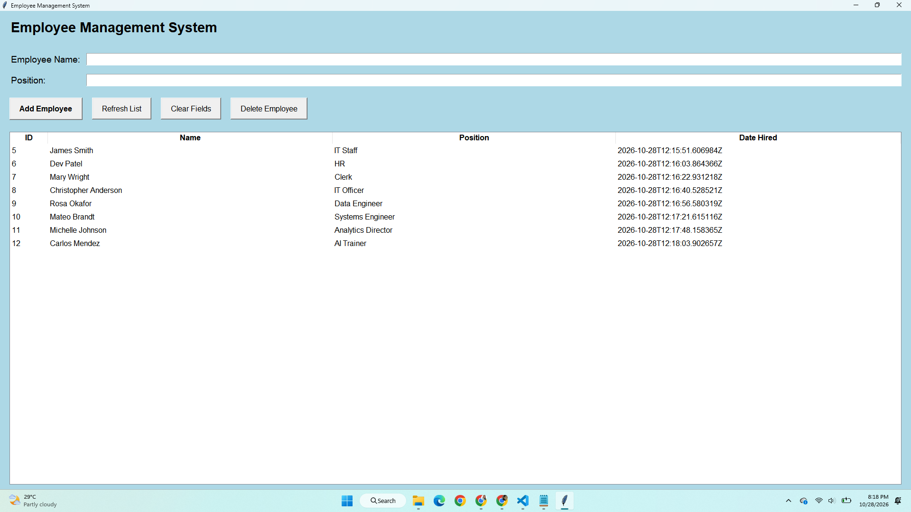
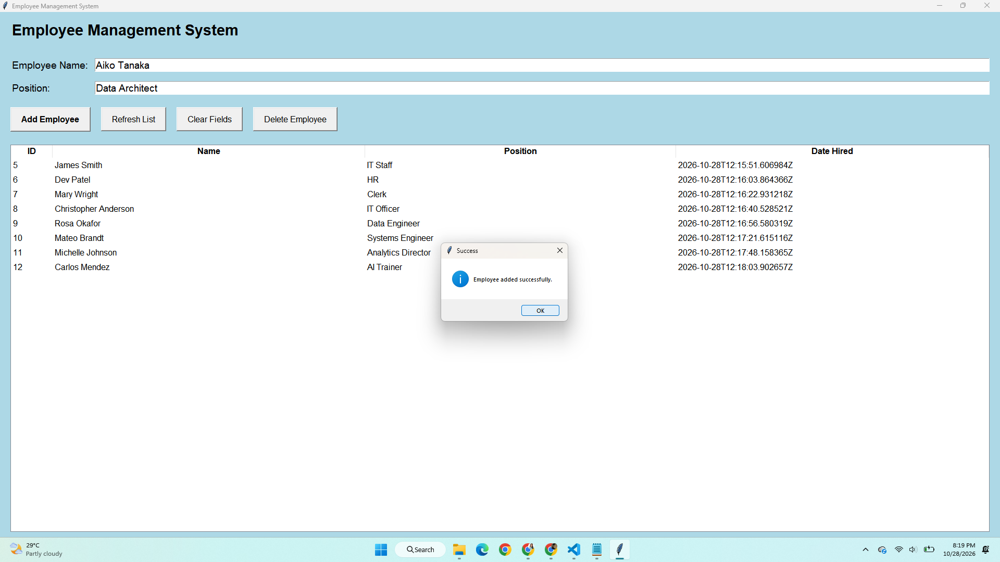
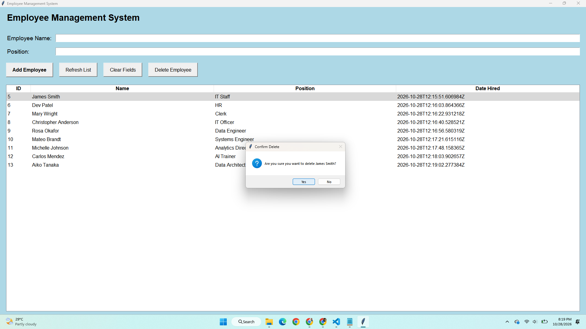

# Employee Management System

Employee Management System using Python Tkinter for the GUI and Django REST Framework for the backend.

## Features
- Add employee
- View and refresh employee list
- Clear input fields
- Delete selected employee
- Store employee records in the database

## Technologies Used
- Python
- Tkinter
- Django

## How to Run

1. Install the required packages:

   ```bash
   pip install django djangorestframework requests
   ```

2. Apply migrations:

   ```bash
   python manage.py migrate
   ```

3. Start the Django server:

   ```bash
   python manage.py runserver
   ```

4. Open another terminal and run:

   ```bash
   python gui.py
   ```

## Screenshots

### Main Interface


### Add Employee


### Delete Employee


## Video Demo

<video src="demo.mp4" width="100%" autoplay loop muted playsinline></video>
